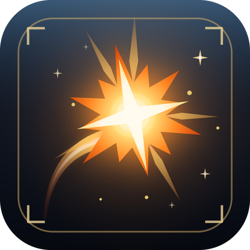

<p align="center">
  
</p>

# HitSpark

**Replace the game's combat numbers with animated, styleable fly text.**

A complete replacement for Final Fantasy XIV's combat text, built on [Dalamud](https://github.com/goatcorp/Dalamud). Damage, healing, misses, status effects and everything else the game floats is redrawn with better typography, tuned motion and real impact on critical hits — in one of eight built-in looks, or one you make yourself and share with a code.

[](https://githixypluginffxiv.vercel.app/plugins/hitspark)
[](https://www.patreon.com/GitHixy)

[](LICENSE)


---

## What it does

### Every kind of combat text

HitSpark takes over the text the game would draw and draws it itself. Each kind has its own style, and can be left to the game or hidden instead:

| Group | Categories |
| --- | --- |
| **Damage dealt** | Auto-attacks, abilities, damage over time, critical hits, direct hits, critical direct hits |
| **Healing** | Heals, heals over time, critical heals, heals received |
| **Damage taken** | Damage taken, critical damage taken, blocked, parried |
| **Avoidance** | Misses, evades, immune / resisted / reflected |
| **Status effects** | Buffs and debuffs gained and lost, resisted or no effect |
| **Everything else** | MP, TP, GP and CP; experience; crafting progress and quality; looted items; interrupted |

Numbers sit above whoever they happened to: the enemy you hit, the party member you healed, or you. What happens to you can instead scroll up a column beside your character, the way classic scrolling combat text does.

### Eight built-in presets

Each preset is a complete look — fonts, colours, paths, timing and impact for every category. They're inspired by how different genres handle combat text, with HitSpark's own names, fonts and colours.

| Preset | The idea |
| --- | --- |
| **Classic+** | The game's own look, refined: its serif numerals with a cleaner outline and a gentle lift. |
| **Heroic** | Classic scrolling combat text: yellow numbers arc off your targets, crits slam in huge, and what hits you scrolls up a column. *(default)* |
| **Tally** | Compact and informative: multi-hits and ticks roll up into one number, tinted by damage type, with the action icon. |
| **Onslaught** | Action-game impact: heavy numbers that slam in, crits that shake and throw sparks, combos stacking on the target. |
| **Elemental** | Playful and bright: numbers spring out of targets with an elastic bounce, in soft colours for each damage type. |
| **Grim** | Dark and weighty: carved numerals that shrink and fade where they land, with burning orange crits. |
| **Minimal** | Small, quiet and still: numbers fade in and out without moving. Easy on motion sensitivity. |
| **Retro** | Eight-bit charm: a pixel font, hard drop shadows and motion that steps like an old console. |

### Motion and impact

- **Paths** — rise, fall, arc, fountain, scrolling column or stay in place, each with its own easing.
- **Entrances and exits** — a pop in (with overshoot, elastic or bounce), a fade and a shrink or grow on the way out.
- **Impact** — punch, shake, a white flash, a burst of sparks and a ghost trail, usually saved for crits.
- **Merging** — hits landing close together can become one number that rolls up as they land. Great for multi-hit abilities and damage over time.
- **No pile-ups** — numbers spawned together on the same target fan out into separate lanes instead of stacking.

HitSpark follows Dalamud's reduced motion setting (or your own choice in **Settings → General**): shake, sparks and trails switch off and arcs become a short rise.

### Damage over time

DoT ticks get their own colour and a small **DoT Tick** caption, so they never blur into direct hits. The game reports ticks as coming from the enemy itself; HitSpark works out who actually applied the DoT, so yours always count as yours.

### Other players

Numbers from actions that don't involve you — a party member hitting the boss, a stranger healing their friend — can be shown smaller, or not at all, separately for your party and for everyone else (**Settings → General → Other players**).

### Make your own

Duplicate any preset and change everything, category by category, while a live preview plays inside the settings window:

- **Text** — font, size, spacing, colour or damage-type tint, gradient, outline, shadow, digit grouping, 12.3K-style abbreviations, prefix, suffix, a fixed caption, the action or status name, and its icon.
- **Motion** — where it anchors, the path and its easing, duration, distance, spread, pop, fades, tilt and stepped motion.
- **Impact** — punch, shake, flash, sparks and ghost trail.
- **Behaviour** — who it shows for (you, your party, others) and whether hits merge.

Copy a style and paste it onto one category or a whole group to build a preset quickly.

### Share presets

**Export** copies a preset as a short code starting with `HS1:` that you can paste anywhere. To use someone else's, copy their code and press **Import from clipboard**. Imported codes are checked and clamped, so a damaged code can't do more than look odd.

### Try it anywhere

**Test in world** plays sample numbers of every kind on you and your target, in or out of combat, so you can judge a preset in the real game. The settings window also has its own preview stage.

---

## Plays by the rules

HitSpark is purely cosmetic.

- **It only shows what the game already shows you.** It redraws text the game was about to display, and follows the game's own **Display flying text** and **Display pop-up text** options. It adds no combat information of any kind.
- **It gets out of the way** in cutscenes, in GPose and when you hide the game's UI.
- **It fails safe.** If a game update breaks it, or it runs into repeated errors, HitSpark steps aside and the game's own numbers come back, with a notice explaining why. `/hitspark native` does the same by hand at any time.
- **It stays on your machine.** No network requests, no data leaving your PC.

---

## Installing

1. Open the plugin installer in game with `/xlplugins`.
2. Search for **HitSpark**.
3. Install and enable it. The **Heroic** preset is on straight away.

---

## Using it

### Commands

| Command | What it does |
| --- | --- |
| `/hitspark` or `/hs` | Open the settings |
| `/hitspark test` | Toggle sample numbers around you and your target |
| `/hitspark native` | Hand all combat text back to the game, or take it over again |

### Settings

Settings are grouped into sections down the left of the window. A status light at the bottom of the list shows whether HitSpark is active.

| Section | What's in it |
| --- | --- |
| **Presets** | Preview, choose, duplicate, rename, delete, export and import presets |
| **Style editor** | Every category of your own presets, with a live preview |
| **General** | Global size and opacity, reduced motion, other players' numbers, the limit on numbers on screen, native mode, test mode |
| **Diagnostics** | Status and counters, an event recorder, the live log, Copy report, and buttons to report a bug or suggest a feature |
| **About** | Version, release notes, shortcuts and credits |

---

## Your data

Settings and your presets are stored in your Dalamud configuration folder, in `pluginConfigs/HitSpark/config.json`. HitSpark makes no network requests; nothing about you, your character or your combat leaves your PC. Preset codes contain only style settings, and only go where you paste them.

---

## Something not working?

1. Open **Settings → Diagnostics** and turn on **Record every combat event**.
2. Make the problem happen again.
3. Press **Copy report**, then **Report a bug**, and paste the report into the issue along with what you did and what you expected.

The recorder notes every combat text event: its kind, who was involved, its values and what HitSpark did with it. It can contain names of nearby players, so check it before posting. It only lives in memory and is cleared when the game closes.

---

## Building from source

You need the [.NET 10 SDK](https://dotnet.microsoft.com/download) and a working Dalamud install — the build finds Dalamud through your XIVLauncher directory.

```bash
git clone https://github.com/GitHixy/HitSpark.git
cd HitSpark
dotnet build -c Release
```

The built plugin lands in `bin/Release/`. To run it as a dev plugin, copy `HitSpark.dll`, `HitSpark.deps.json`, `HitSpark.json` and the `Assets` folder into `%AppData%\XIVLauncher\devPlugins\HitSpark\`, then reload it from `/xlplugins` → Dev Tools.

`icon.png` is generated by `tools/make_icon.py` (Python with Pillow and NumPy), which shares its palette with `src/UI/Theme.cs`. Run `python tools/make_icon.py` from the repository root after changing it.

### How it works

[docs/DESIGN.md](docs/DESIGN.md) covers the whole design: how events are captured and matched to actors, the preset and style model, the render loop, and which assumptions about the game were checked in game and how. In short:

- Two hooks on the game's screen log, with addresses from [FFXIVClientStructs](https://github.com/aers/FFXIVClientStructs), catch each piece of combat text as the game queues it, with who was involved. HitSpark draws it and skips the queue, which suppresses both fly text and pop-up text. A third, optional hook on the game's DoT/HoT processing credits each tick to whoever applied it.
- Styles are compiled into flat structures when a preset changes, and numbers live in a fixed pool of instances, so drawing a frame allocates nothing. It is built to stay cheap with many players and DoTs on screen; a hard cap (Settings → General) bounds the worst case.
- Text is drawn with ImGui on the background draw list. Rotation and gradients are applied to the vertices of the glyphs just drawn.

---

## Release notes

The plugin shows what's new the first time you log in after an update, and you can reopen it any time from **Settings → About → What's new**.

**0.1.0** is the first release: the full renderer, eight presets, the style editor, preset sharing, test mode and diagnostics.

Full history is on the [Releases](https://github.com/GitHixy/HitSpark/releases) page.

---

## Contributing

Issues, feature requests and pull requests are all welcome — use the [issue tracker](https://github.com/GitHixy/HitSpark/issues). For bugs, a Copy report from **Settings → Diagnostics** helps a lot. Made a preset you're proud of? Share its code in an issue — good ones may become built-ins.

## Support the plugin

HitSpark is free and always will be. If you enjoy it, support on Patreon is genuinely appreciated.

[](https://www.patreon.com/GitHixy)

## Licence

HitSpark is licensed under [GPL-3.0](LICENSE).

The bundled fonts are licensed under the [SIL Open Font License 1.1](https://openfontlicense.org/); each one's licence is in [`Assets/Fonts/licenses`](Assets/Fonts/licenses):

| Font | Used by |
| --- | --- |
| Russo One | Heroic |
| Barlow Condensed | Tally |
| Anton | Onslaught |
| Lilita One | Elemental |
| Cinzel Decorative | Grim |
| Barlow | Minimal |
| Press Start 2P | Retro |
| Bebas Neue | Available in the editor |

Classic+ uses the game's own fonts, loaded from your installation; they are not distributed with HitSpark.

## Thanks

- The [Dalamud](https://github.com/goatcorp/Dalamud) team, for the plugin framework.
- The [FFXIVClientStructs](https://github.com/aers/FFXIVClientStructs) contributors, for mapping the game's screen log, status and object structures.
- The authors of [CBT](https://github.com/cultbaus/CBT), [DamageInfoPlugin](https://github.com/perchbirdd/DamageInfoPlugin), [MultiHit](https://github.com/Bluefissure/MultiHit) and [FlyTextFilter](https://github.com/Aireil/FlyTextFilter), whose work showed how the game's combat text flows. HitSpark was written from scratch and contains no code from them.
- The designers of the fonts above, for sharing them under the Open Font License.
- The FFXIV plugin community, for the help and the example.

---

*Not affiliated with Square Enix. FINAL FANTASY XIV © SQUARE ENIX CO., LTD.*
